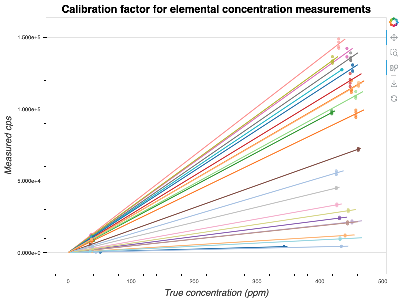
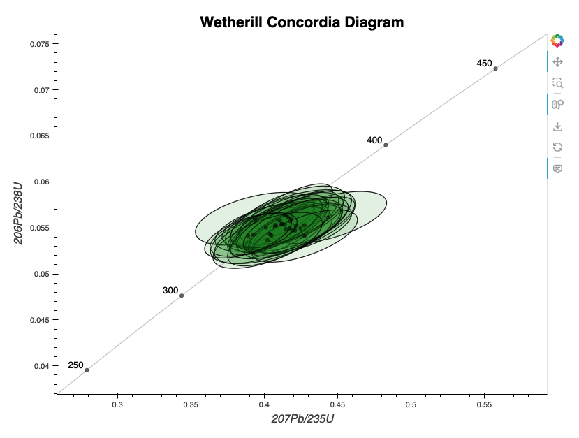

# UPbRPy

U-Pb data (R)eduction engine in Python for LA-ICP-MS data. Currently supports data collected with a Thermo iCAP RQ ICP-MS coupled to a Teledyne Analyte Excite+ 193 nm excimer laser ablation system.

## About
UPbRPy is developed with a goal of providing a Python-based reproducible data reduction and final result visualization workflow for U-Pb LA-ICP-MS data. The package features:

**1) fast data reduction with no limits on individual spot analyses duration and spot numbers per experiment session**\
**2) elemental abundance analysis and isotopic analysis from the same spots**\
**3) downhole isotope fractionation correction**\
**4) uncertainty propagation at the sweep-level (for depth profiles) and spot-level (for conventional spot means)**\
**5) interactive data visualization throughout the data reduction process**\
**6) export depth profile data**\
**7) making publication-ready figures**


### interactive time series visualization


### Elemental concentration calibration


### Downhole fractionation characterization and correction


### Session-wide fractionation correction


### Concordia diagram visualization
- example Plešovice zircon LA-ICP-MS data



## Executable examples

Compact, executed notebooks now live in the separate private
[UPbRPy-examples](https://github.com/duserzym/UPbRPy-examples) repository.
This source repository keeps the reusable calculation and visualization code;
production analytical sessions remain in the LAICPMS database repository.

The maintained mapping between the methods-paper sequence and the shared
numerical core is documented in
[`docs/manuscript_workflow_compatibility.md`](docs/manuscript_workflow_compatibility.md).

## Installation
pip release will be made available. During development, the most reproducible setup is the conda environment defined in `UPbR_environment.yml`.

Create the development environment:

```bash
conda env create -f UPbR_environment.yml
conda activate UPbRPy
```

If you already have the environment and pull new dependencies from the repo, update it with:

```bash
conda env update -f UPbR_environment.yml --prune
conda activate UPbRPy
```

The environment targets Python 3.14 and installs the current scientific,
plotting, notebook, test, and desktop GUI stacks declared in `pyproject.toml`.
The package itself supports Python 3.12 and newer.

For packaging and release work, the repo now also includes a `pyproject.toml` so the project can move toward standard `pip` installs instead of being conda-only.

Install the library in editable mode:

```bash
pip install -e .
```

Install the library plus the desktop GUI dependencies:

```bash
pip install -e ".[gui]"
```

Install all development, notebook, test, and GUI dependencies without Conda:

```bash
python3.14 -m venv .venv
source .venv/bin/activate
python -m pip install -e ".[gui,dev]"
```

That editable install is the recommended way to make a repo-local `.venv` usable for both VS Code analysis and `python -m GUI` launches.

### Baseline and peak selection

Window selection is implemented in `UPbRPy.io` so experiment import, notebooks,
and the GUI use the same algorithms. `UPbRPy.selection` remains as a compatibility
import path. The original percentile-based threshold remains the default. A
running-baseline method detects signal when one or more sweeps exceed the
preceding running mean by a configurable number of standard deviations:

```python
from UPbRPy.io import select_signal_regions

selection = select_signal_regions(
    signal,
    method="rolling_sigma",
    baseline_sweep_n=10,
    peak_sweep_n=20,
    rolling_window=5,
    sigma_threshold=5,
    consecutive=2,
)
print(selection.as_tuple(), selection.diagnostics)
print(selection.signal_start, selection.signal_end)
```

The `excel_expanding_sigma` method reproduces the onset test extracted from
`Zircon_28Mar25_Zhang1-i193-LA-UPbR22.xlsm`: beginning with six baseline
sweeps, compare each following value against the mean of all preceding sweeps
plus a configurable positive number of sample standard deviations (eight by
default). The workbook then takes the median onset
across samples to align its column-oriented raw data; UPbRPy's file-per-spot
workflow applies the same onset detector independently to each spot. Selection
also locates the falling washout edge using a rolling robust signal trend. The
inclusive signal end is the last falling-tail sweep that remains above both
the configurable washout sigma threshold (three sigma by default) and a small
fraction of the baseline-to-plateau elevation (five percent by default). A
later run of baseline-like sweeps confirms stable washout recovery. Plateau end
is clamped to the signal boundary so a fixed plateau length cannot include the
washout tail or post-signal baseline.

An optional elapsed-time ceiling can make this endpoint stricter for sessions
whose isotope ratios become unstable during a low-signal tail. It is measured
from the detected signal start and snaps to the nearest measured sweep. The
default is `None`, which preserves the unrestricted algorithmic pick:

```python
selection = select_signal_regions(
    signal,
    time=time,
    signal_duration_limit_seconds=9.0,
)
```

The notebook `selection_editor` marks signal start and end separately from the
baseline and plateau windows. It offers the Excel expanding-sigma detector with
an editable sigma threshold, and an Excel-style iterative 95% (approximately
2-sigma) detrended plateau filter. Included plateau points are filled, rejected
points are hollow, and live mean bars plus mean ± 2-sigma rectangles update as
either window is moved. Exact statistics sit outside the plotting canvas.

The same method can be applied during experiment import:

```python
from UPbRPy import read_experiment_data

experiment, channels, total_data = read_experiment_data(
    directory,
    signal_duration_limit_seconds=9.0,  # omit or use None for no time cap
    selection_method="rolling_sigma",
    selection_options={
        "rolling_window": 5,
        "sigma_threshold": 5,
        "consecutive": 2,
    },
)
```

If you prefer to work from source without installing the package, add the path to the `UPbRPy` folder to your Python path by adding the following lines to your script:
```python
import sys
import os
sys.path.append(os.path.join(os.path.dirname(__file__), 'PATH_TO_UPbRPy'))
```
where `PATH_TO_UPbRPy` is the absolute path to the `UPbRPy` folder. 

Alternatively, you can add the path to the `UPbRPy` folder to your Python path in your environment variables. For MacOS and Linux, you can do this by adding the following line to your `.bash_profile` or `.bashrc` or `.zshrc` file:  
```bash
export PYTHONPATH=$PYTHONPATH:/path/to/UPbRPy
```
For Windows, I assume you can do this by adding the following line to your `Environment Variables`:
```bash
set PYTHONPATH=%PYTHONPATH%;C:\path\to\UPbRPy
```

### Desktop GUI
UPbRPy Studio lives in `GUI/` and uses `PySide6 + pyqtgraph`. The native
application and notebooks call the same `ReductionPipeline`; the GUI does not
maintain a second implementation of the scientific calculations.

Projects open as tabs in one Studio window. Each tab keeps its own reduction,
Detector settings, and Database origin. **File → Open Project**, **Open
Experiment Folder**, and **Open Qtegra file** use a new tab, reusing the active
tab when it is empty and idle. A `•` before the tab title marks unsaved changes;
hover over it to see the full project or source path.

Use **Ctrl+T** (or the platform New shortcut) for a new tab, **Ctrl+Tab** and
**Ctrl+Shift+Tab** to cycle tabs, and **Ctrl+W** (or the platform Close shortcut)
to close a tab. **Ctrl+S** saves the active project. **Window → Move Tab to New
Window** moves the current reduction with its state intact; **Ctrl+Shift+N**
opens an empty Studio window. Closing the last tab leaves an empty tab.


Screenshots of two tabs (the Boise per-spot folder, merged with its Rich file,
and the Rich file alone) at 1280 × 800 and 1440 × 900 are in
`docs/screenshots/studio_tabs_*.png`.

The zircon, apatite, rutile, and titanite presets expose an explicit processing
sequence from import and window review through downhole/session calibration,
depth profiles, common-Pb decisions, automatic flags, and final results.
Long-running stages execute on background workers. The plot uses downsampling,
and final tables use a virtual Qt data model so large sessions remain
responsive.

The periodic-table-style isotope selector distinguishes active, inactive, and
selected channels using shape and borders as well as color. Signal start/end
and baseline/plateau selections are editable in the trace view. Calibration
materials, fit models, outlier filtering, common-Pb method, calibration
uncertainty, and preferred-age transition are represented directly in the
shared pipeline configuration.

Publication exports follow a Horstwood Table 4-style layout and keep
analytical, calibration-inclusive, and optional systematic uncertainty
components explicit. See
[`docs/uncertainty_and_publication_exports.md`](docs/uncertainty_and_publication_exports.md)
for the baseline, physical-constant, long-term reproducibility, initial-Pb,
and concentration-export conventions.

The interface shows a compact icon-and-label workflow rail, plots, and the
spot/isotope inspector together on large displays. The complete ordered
sequence fits without scrolling on normal screens, while the selected step's
explanation and actions appear above the plot. Side panels collapse on smaller
monitors and can be restored from the View menu. File, Workflow, Calibration,
Results, View, and Help menus expose the same operations without depending on
panel visibility.
On a laptop (tested at 1440 × 900 and 1280 × 800 points) the header becomes
one line, the auto-pick settings fold behind a toggle in the workflow rail,
the notes and activity log start hidden (**View → Reduction Notes and
Activity Log**, Ctrl+Shift+L), and long labels shorten with "…" rather than
widening the window. The window size and every panel width are remembered;
**View → Reset Layout** fits the default layout to the current screen.

Run the desktop application from source with:

```bash
python -m GUI
```

Or run the console script after installing with `pip install -e ".[gui]"`:

```bash
upbrpy-gui
```

Use **File → Save Project** at any point after import to write a lightweight
`.upbr` project. The human-readable project stores source and reference-library
paths, all reduction settings, reviewed selection windows, completed stage
identifiers, and compact workspace choices; it does not duplicate raw sweeps
or calculated tables. **File → Open Project** resolves portable relative paths
first, re-imports the raw files, restores the saved parameters and selections,
and recalculates the stages that were complete when the project was saved.

Use **File → Export Publication + Reproducibility Bundle** to write a formatted
Excel workbook, companion CSV tables, selection windows, spot and depth-profile
data, a reduction manifest, and a Jupyter notebook. The notebook embeds the
reviewed GUI selections and recreates the same TOML-first reference-material
library with legacy CSV fallback, so it can replay the complete GUI reduction
with the shared Python core.

#### Database mode (optional)

Everything above works without a server and stays unchanged. A lab that runs
[laicpmsdb](https://github.com/duserzym/laicpmsdb) can also move sessions and
reductions over HTTP; the cross-repository contract is
`upbstudio/docs/WORKFLOW.md` v1 and the plan is
[`docs/lab_workflow_integration.md`](docs/lab_workflow_integration.md).
Install the optional extra (`requests` and `keyring`):

```bash
pip install -e ".[gui,database]"
```

- **In.** A session page's *Reduce in UPbRPy Studio* link,
  `upbr://session/<id>?server=…&code=…`, opens Studio, which trades the
  one-time code for a token, downloads the *session bundle* (raw CSVs
  byte-identical, `session_manifest.toml`, a pre-filled `.upbr`) into
  `~/UPbRPy/sessions/<session_key>/`, verifies every file's SHA-256, and opens
  it. **File → Database → Open from Database…** does the same from a server
  address, a password or ORCID sign-in, and a session list. The window title
  and the workflow rail show the database origin.
- **Out.** **File → Database → Submit to Database** writes the reduction
  bundle (with input hashes and the `.upbr`), posts it as a new run of the
  session, shows the run id and any quarantined items, and records
  `origin.run_id` in the project. **Mark as Preferred** makes that run the
  session's preferred run.
- Tokens are kept per server in the OS keychain (macOS Keychain, Windows
  Credential Manager), never in files. Without the extra the database
  actions are disabled with the reason as tooltip.
- `upbrpy-gui --open` accepts a folder, a `.upbr`, a session-bundle `.zip`
  (what a database user can email to someone without the database), or a
  `upbr://session/…`, `upbr://run/…` or `upbr://auth/callback?code=…` link. A
  second launch with a link hands it to the running Studio. The macOS app
  declares the `upbr` scheme; on Windows run
  `"UPbRPy Studio.exe" --register-url-scheme` once (or **File → Database →
  Register upbr:// Links**) to write `HKCU\Software\Classes\upbr`.

In notebooks, `read_experiment_data` reads a session bundle's folder directly:
it finds `session_manifest.toml` beside `raw/` and takes the label separator
and sample aliases from it (explicit arguments still win).

Run the tests as if the extra were absent, in an environment that has it:

```bash
UPBRPY_BLOCK_IMPORTS=requests,keyring QT_QPA_PLATFORM=offscreen .venv/bin/python -m pytest tests -q -p no:cacheprovider
```

To regenerate the Qtegra fixture on the laptop, run
`.venv/bin/python scripts/make_qtegra_fixture.py "/path/to/LAICPMS_data"`
against the folder containing `Zircon_demo_Rich.csv`
and `zircon_04Nov26/`. The defaults copy the first 12 acquisitions and 9 of
29 channels into
`tests/fixtures/qtegra/Zircon_04Nov26_slice/`; `-n`, `--channels` (or
`--channels all`), and `--out` override the slice and destination. Cell text,
BOMs and CRLF line endings are preserved; the full exports stay off git.

#### Building the desktop application

The checked-in PyInstaller recipe produces a native on-directory application,
bundles the TOML reference-material library and vector/raster icons, and then
launches the frozen GUI offscreen to verify that it renders a real window.
Install the build dependencies into the same environment used for the
scientific stack and run:

```bash
python -m pip install -e ".[gui,build]"
python scripts/build_desktop.py --archive
```

Builds now stay outside the source checkout. Defaults are
`~/Library/Caches/UPbRPy/<checkout-id>/` on macOS,
`${XDG_CACHE_HOME:-~/.cache}/UPbRPy/<checkout-id>/` on Linux, and
`%LOCALAPPDATA%/UPbRPy/<checkout-id>/` on Windows. The script prints the exact
application, screenshot, and archive paths. Override the root with
`UPBRPY_BUILD_ROOT`, or pass external `--dist-dir` and `--work-dir` directories.
Paths inside the source repository are rejected.

The macOS app is `dist/UPbRPy Studio.app` inside that cache; Windows uses
`dist/UPbRPy Studio/UPbRPy Studio.exe`. The ZIP preserves the application bundle
for transport. Keep the `dist` application while using it; the disposable `work`
cache can be removed after building. Development virtual environments can also
live outside the repository (a local ignored `.venv` symlink is supported).

To exercise numerical reduction and publication export in the frozen executable,
run it with `--verify-reduction /path/to/session --verification-output /path/to/scratch`.
It writes a full bundle plus `verification.json`, exits nonzero on export errors,
and records whether the runtime was frozen. The GitHub Actions desktop workflow
performs the source tests, frozen-app screenshot smoke test, and ZIP upload for
macOS arm64 and Windows x86-64 on version tags or manual dispatch. Release
signing and Apple notarization are intentionally separate because they require
maintainer certificates and repository secrets.

## Data model

The [UPbRPy data model](docs/data-model/index.md) specifies accepted inputs,
the acquisition model, reference-material TOML, projects and bundles.
Build the site with `make docs` (override `MKDOCS` and `SITE_DIR` as needed);
`make docs-serve` serves it locally. Build output defaults to the external
UPbRPy cache directory.

The site deploys by manual dispatch of the `docs-pages` GitHub Actions
workflow. Set GitHub Pages to **GitHub Actions** in the repository settings
once before deploying.

### Qtegra exports

UPbRPy accepts a Rich single CSV, a per-spot folder or file, a folder with
these exports, a session bundle root, or a `QtegraSession`.
The **Rich CSV is the canonical acquisition record**; the per-spot folder
supplies companion metadata. Opening a folder holding a Rich file and its
per-spot files (in the same folder or one immediate subfolder) merges them
by label after checking Y values and sweep times.

| Exported information | Rich single CSV | Per-spot folder |
| --- | --- | --- |
| Analog and pulse-counter readings | Yes | No |
| Per-channel sweep time | Yes | First channel's time only |
| Acquisition start / stop times | Both | Start only |
| Channel mass | Yes | No |
| Dwell time / xcal factor | No / recoverable on saturated sweeps | Both |
| Instrument state (tune settings, readbacks) | Yes | Yes |
| Sample-list fields | Yes | No |

Both contain Y (cps used for reduction). The UPbR single CSV was dropped
2026-11-05 because it contains only Y and has no time information. Opening
one raises `UnsupportedQtegraFormat` with instructions to export Rich or
per-spot data. Folder discovery skips it with a warning when usable exports
exist; a folder containing only unsupported exports raises the same error.
Reduced Rich files need only the two header rows, MainRuns Y for every
channel, and either MainRuns Time or StartTime. Other row groups are optional;
capabilities describe what was exported. Analog and Counter must both exist
to enable detector calibration.

Without Time rows, sweep offsets are reconstructed from StartTime using
`cycle_time_s` (default 0.4255 s), with a warning and timing provenance.
Pass it as a keyword to `read_rich_csv`, `open_qtegra`, or
`read_experiment_data`; recorded Time rows and per-spot input ignore it.
StopTime is never used to estimate sweep spacing. Without StartTime,
experiment import uses a continuous sequence axis; calendar gaps cannot be
recovered, and merging per-spot companions requires StartTime.

```python
from UPbRPy.io import read_experiment_data
from UPbRPy.qtegra import open_qtegra

path = "session_Rich.csv"  # or "per_spot/", "spot.csv", "session/"
experiment, channels, total_data = read_experiment_data(path)
session = open_qtegra(path)  # acquisition arrays, metadata and source hashes
```

In Studio, use **File → Open Experiment Folder** for per-spot or combined
folders, and **File → Open Qtegra file** for Rich or per-spot CSVs. The
session badge shows the format, capabilities and warnings. Opening a Rich
file directly reads that file alone.

### Detector cross-calibration

Qtegra exports `Y = counter` where the pulse counter is valid, and
`Y = analog × xcal` where the counter reads `-33` (saturated). Its xcal is
one tuning-time constant per channel. With Rich analog/counter readings,
UPbRPy offers three modes through `read_experiment_data(...,
detector_calibration=...)` or Studio's **Calibration → Detector** panel:

- `qtegra` (default): keep exported Y.
- `constant`: fit one factor per channel for the session.
- `drift`: fit per-acquisition slopes at the constant fit's intercept,
  then smooth over session time with a Gaussian kernel, bandwidth
  `smoothing_s=1800.0` s and inverse-variance weights.

Both fitted modes use an inclusive overlap window of **1e5 to 2.4e6 counter
cps** and ordinary least squares of counter on analog with an intercept.
The basis is `on="all"` (default) or `on="primary_standard"`, with
`primary_standard` naming the sample. For example,
`detector_calibration={"mode": "drift", "on": "primary_standard",
"primary_standard": "S513"}` selects S513. Corrected saturated Y uses
**analog × factor only**; the intercept is reported but not applied.

Measured on the full `Zircon_demo` session (Boise iCAP RQ,
245 acquisitions; errors below are one standard error):

| Channel / basis | Session constant | Qtegra factor |
| --- | --- | --- |
| 238U, all (4,982 sweeps, 212 acquisitions) | 103,809 ± 136 | 109,642 |
| 238U, S513 only | 104,178 ± 552 | 109,642 |
| 29Si, all | 65,044 ± 65 | 65,696 |

The smoothed 238U drift on all acquisitions falls from 103,992 at the start
to 103,291 after 2.5 h. The applied mode and fit results are recorded in
`experiment.attrs["detector_calibration"]`, `reduction_manifest.json`, and
publication-table settings; the choice is kept in
`PipelineConfig.detector_calibration` and the `.upbr` project.


See [`docs/qtegra_export_formats.md`](docs/qtegra_export_formats.md) for the
export contract and [`docs/lab_workflow_integration.md`](docs/lab_workflow_integration.md#6-qtegra-input-layer-for-laicpmsdb)
for the ingest API and storage rules.

### Bug reports and issue discussions
I write bugs. And the only way to deal with this is to keep thinking about the functions and keep fixing them. If you find any issues with the code, please let me know. You can do this by submitting an issue on the [Issues](https://github.com/duserzym/UPbRPy/issues) page of this repository. It'd be lovely if you can provide a minimal example that reproduces the bug.
