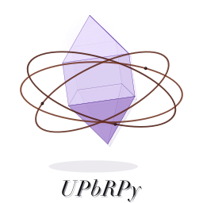

# UPbRPy

Python reduction engine and desktop Studio for LA-ICP-MS U-Pb and trace-element data.

[Documentation](https://duserzym.github.io/UPbRPy/) ·
[Download Studio](https://github.com/duserzym/UPbRPy/releases) ·
[MIT license](LICENSE)

UPbRPy reads Thermo iCAP RQ/Qtegra exports from a Teledyne Analyte 193 nm laser
workflow. The engine and PySide6 Studio share the same reduction pipeline.
Zircon, apatite, rutile and titanite presets guide window review, baseline
subtraction, internal normalization and calibration. U-Pb ratios and trace
elements come from the same spots, with separate downhole and session
fractionation corrections, sweep-level uncertainty, depth profiles and
publication tables.

## Workflow tour

Screenshots use real measurements with neutral sample labels and no acquisition
metadata. They illustrate the interface, not an endorsed reduction of a sample.
The [manual](https://duserzym.github.io/UPbRPy/manual/import/) explains each control
and the checks needed before interpreting results.

| Import and auto-pick | Review baseline, plateau and signal |
| --- | --- |
| 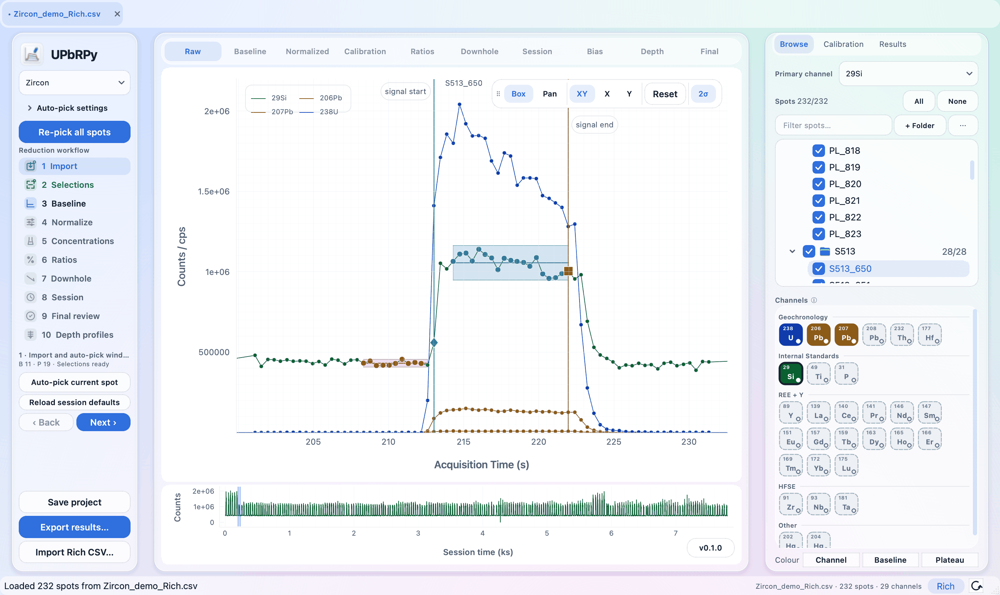 | 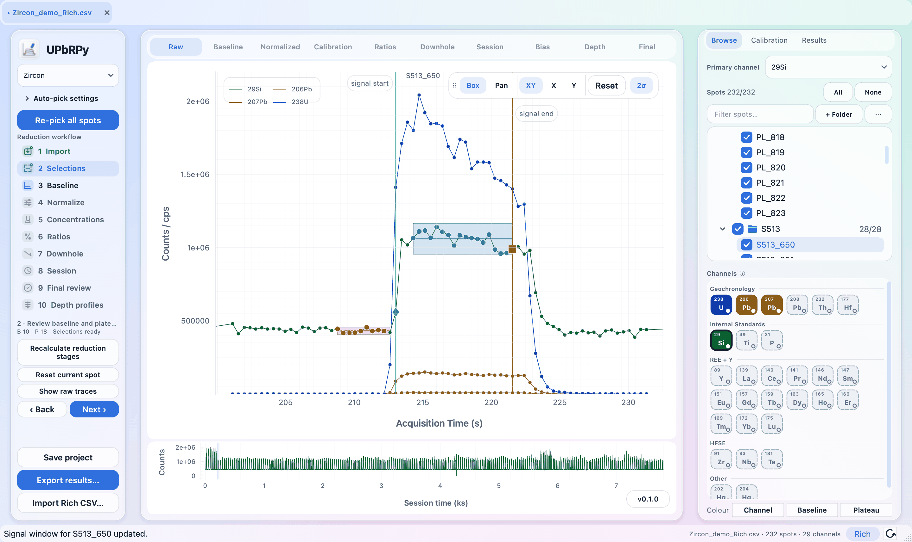 |
| Subtract baseline | Internal normalization |
| 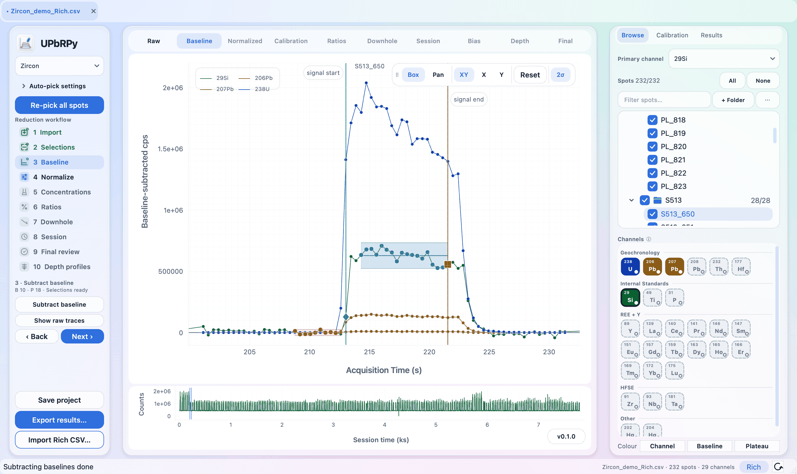 | 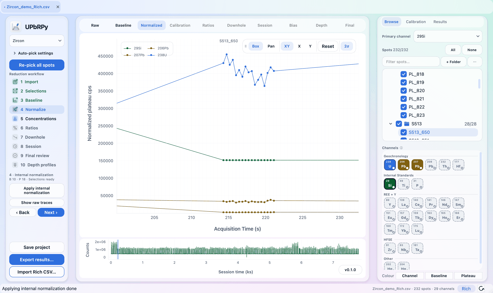 |
| Concentration calibration | Raw isotope ratios |
| 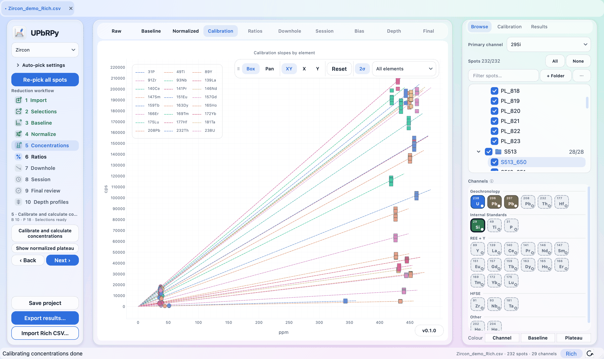 | 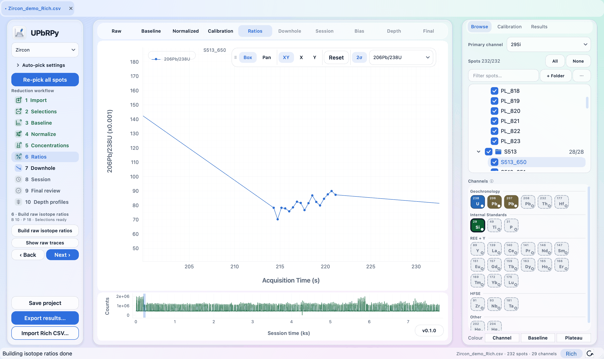 |
| Downhole correction | Session fractionation correction |
| 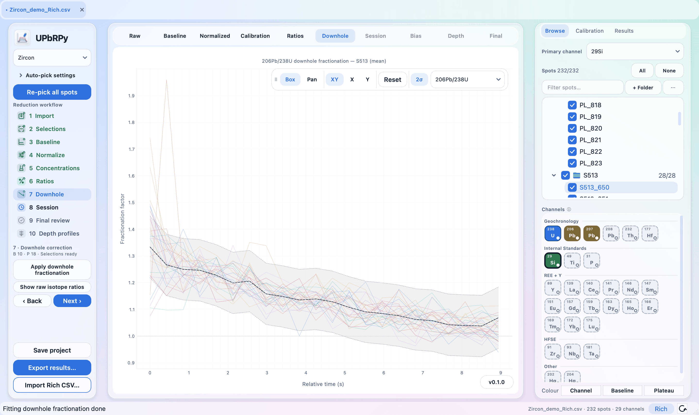 | 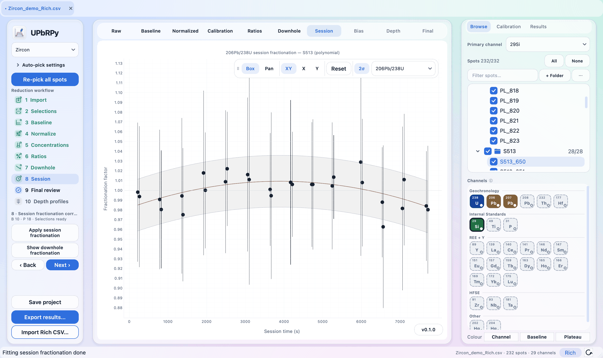 |
| Final results | Spot concordia |
| 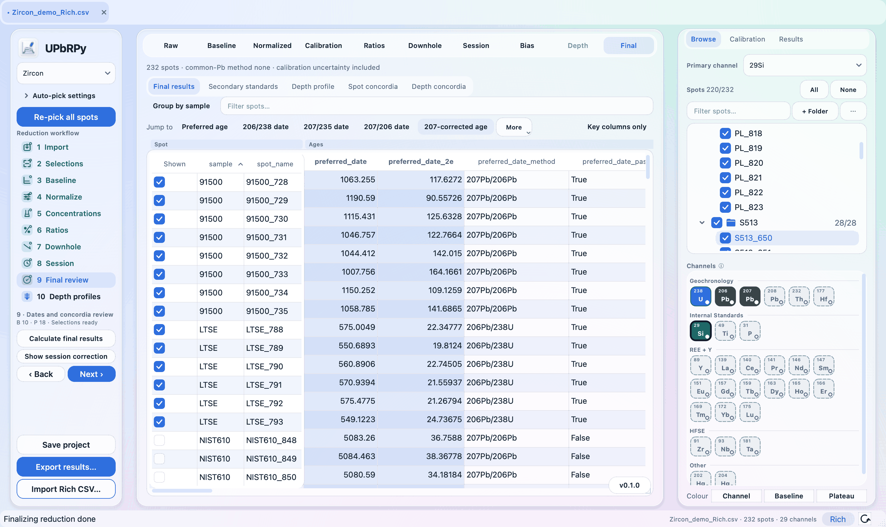 | 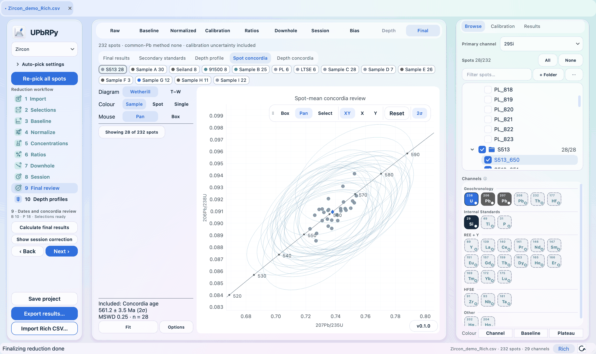 |
| Depth profiles | Database sign-in |
| 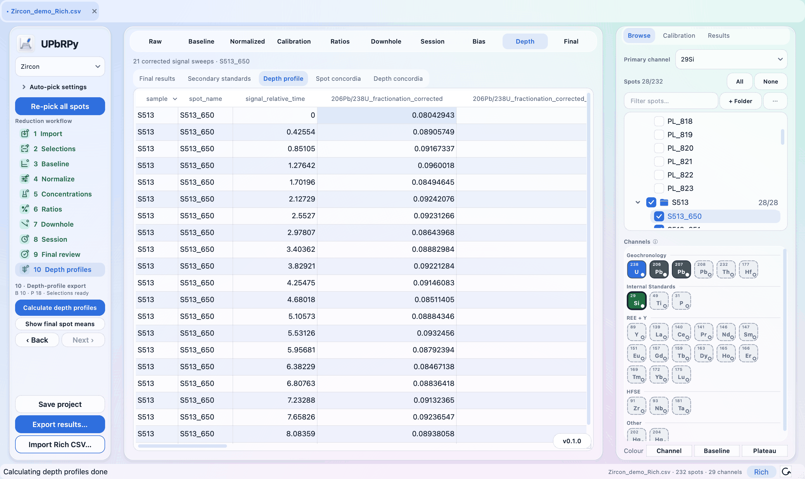 | 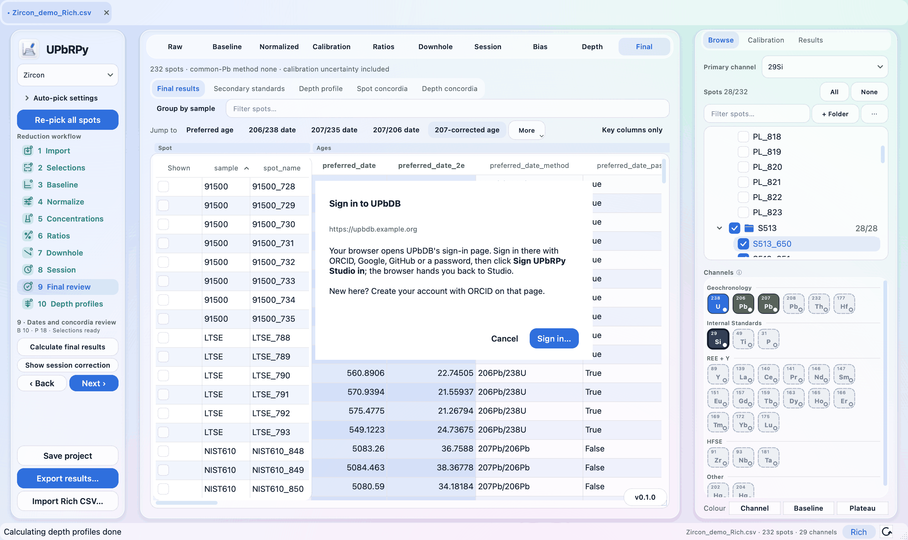 |

## Install

Download Studio from [GitHub Releases](https://github.com/duserzym/UPbRPy/releases).
The macOS arm64 build is signed with the lab's own certificate and is not
notarized. Unzip it, move the app to Applications and launch it. If macOS blocks
the first launch, use **System Settings > Privacy & Security > Open Anyway**
after attempting to open the app.

**Help > Check for updates** offers Stable and Beta channels. Downloaded
archives are SHA-256 verified before **Restart to update** is offered.
[Install and first launch](https://duserzym.github.io/UPbRPy/get-started/install/)
provides details.

From a source checkout, with Python 3.12 or newer:

```sh
python -m venv .venv
source .venv/bin/activate
python -m pip install -e ".[gui]"
upbrpy-gui
# Equivalent launch: python -m GUI
```

On Windows use `.venv\Scripts\activate`. For the engine alone install with
`python -m pip install -e .`. Optional extras include `database`, `notebook`,
`export`, `docs`, `build` and `dev`.

```python
from UPbRPy.io import read_experiment_data

experiment, channels, sweeps = read_experiment_data("Zircon_demo_Rich.csv")
```

The [Python API guide](https://duserzym.github.io/UPbRPy/reference/python-api/)
shows the reduction pipeline and publication-table writers. Use a Rich CSV or
per-spot exports; the Rich CSV is the canonical record. Y-only UPbR CSV files
are unsupported because they contain no timing.

## Lab workflow

[UPbDB](https://github.com/duserzym/upbdb) stores raw sessions, acquisitions,
spot links and reduction runs. Studio can open a session bundle, link a local
reduction to its database session, submit a new run and mark it preferred.
Install `.[gui,database]` for these optional actions.

[UPb Lab](https://github.com/duserzym/upblab) provides the lab workspace for
sessions, images and result review. It opens a selected session in the separate
Studio application and reviews results submitted back to UPbDB.

## Citation and links

Use [CITATION.cff](CITATION.cff) for citation metadata.

- [Application manual](https://duserzym.github.io/UPbRPy/)
- [Data model](docs/data-model/index.md) and [Qtegra export contract](docs/qtegra_export_formats.md)
- [Build Studio](docs/development/building.md) and [tests](docs/testing.md)
- [Contributing](docs/development/contributing.md) and [bug reports](https://github.com/duserzym/UPbRPy/issues)
- [License: MIT](LICENSE)
