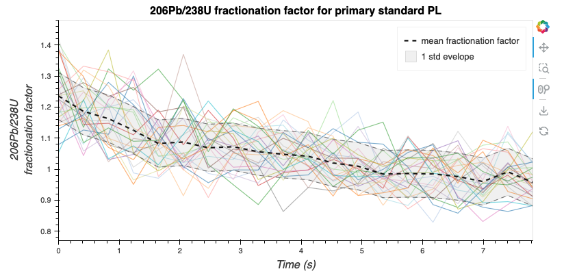
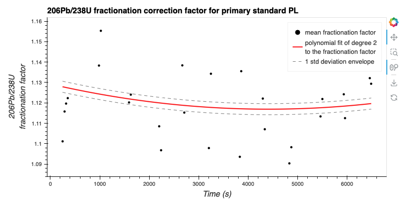

# UPbRPy

U-Pb data (R)eduction engine in Python for LA-ICP-MS data. Currently supports data collected with a Thermo iCAP RQ ICP-MS coupled to a Teledyne Analyte Excite+ 193 nm excimer laser ablation system.

## About
UPbRPy is developed with a goal of providing a Python-based reproducible data reduction and final result visualization workflow for U-Pb LA-ICP-MS data. The package features:

**1) fast data reduction with no limits on individual spot analyses duration and spot numbers per experiment session**\
**2) elemental abundance analysis and isotopic analysis from the same spots**\
**3) downhole isotope fractionation correction**\
**4) uncertainty propagation at the sweep-level (for depth profiles) and spot-level (for conventional spot means)**\
**5) interactive data visualization throughout the data reduction process**\
**6) export depth profile data**\
**7) making publication-ready figures**


### interactive time series visualization


### Elemental concentration calibration


### Downhole fractionation characterization and correction


### Session-wide fractionation correction


### Concordia diagram visualization
- example Plešovice zircon LA-ICP-MS data


## Executable examples

Compact, executed notebooks now live in the separate private
[UPbRPy-examples](https://github.com/duserzym/UPbRPy-examples) repository.
This source repository keeps the reusable calculation and visualization code;
production analytical sessions remain in the LAICPMS database repository.

The maintained mapping between the methods-paper sequence and the shared
numerical core is documented in
[`docs/manuscript_workflow_compatibility.md`](docs/manuscript_workflow_compatibility.md).

## Installation
pip release will be made available. During development, the most reproducible setup is the conda environment defined in `UPbR_environment.yml`.

Create the development environment:

```bash
conda env create -f UPbR_environment.yml
conda activate UPbRPy
```

If you already have the environment and pull new dependencies from the repo, update it with:

```bash
conda env update -f UPbR_environment.yml --prune
conda activate UPbRPy
```

The environment targets Python 3.14 and installs the current scientific,
plotting, notebook, test, and desktop GUI stacks declared in `pyproject.toml`.
The package itself supports Python 3.12 and newer.

For packaging and release work, the repo now also includes a `pyproject.toml` so the project can move toward standard `pip` installs instead of being conda-only.

Install the library in editable mode:

```bash
pip install -e .
```

Install the library plus the desktop GUI dependencies:

```bash
pip install -e ".[gui]"
```

Install all development, notebook, test, and GUI dependencies without Conda:

```bash
python3.14 -m venv .venv
source .venv/bin/activate
python -m pip install -e ".[gui,dev]"
```

That editable install is the recommended way to make a repo-local `.venv` usable for both VS Code analysis and `python -m GUI` launches.

### Baseline and peak selection

Window selection is implemented in `UPbRPy.io` so experiment import, notebooks,
and the GUI use the same algorithms. `UPbRPy.selection` remains as a compatibility
import path. The original percentile-based threshold remains the default. A
running-baseline method detects signal when one or more sweeps exceed the
preceding running mean by a configurable number of standard deviations:

```python
from UPbRPy.io import select_signal_regions

selection = select_signal_regions(
    signal,
    method="rolling_sigma",
    baseline_sweep_n=10,
    peak_sweep_n=20,
    rolling_window=5,
    sigma_threshold=5,
    consecutive=2,
)
print(selection.as_tuple(), selection.diagnostics)
print(selection.signal_start, selection.signal_end)
```

The `excel_expanding_sigma` method reproduces the onset test extracted from
`Zircon_28Mar25_Zhang1-i193-LA-UPbR22.xlsm`: beginning with six baseline
sweeps, compare each following value against the mean of all preceding sweeps
plus a configurable positive number of sample standard deviations (eight by
default). The workbook then takes the median onset
across samples to align its column-oriented raw data; UPbRPy's file-per-spot
workflow applies the same onset detector independently to each spot. Selection
also locates the falling washout edge using a rolling robust signal trend. The
inclusive signal end is the last falling-tail sweep that remains above both
the configurable washout sigma threshold (three sigma by default) and a small
fraction of the baseline-to-plateau elevation (five percent by default). A
later run of baseline-like sweeps confirms stable washout recovery. Plateau end
is clamped to the signal boundary so a fixed plateau length cannot include the
washout tail or post-signal baseline.

An optional elapsed-time ceiling can make this endpoint stricter for sessions
whose isotope ratios become unstable during a low-signal tail. It is measured
from the detected signal start and snaps to the nearest measured sweep. The
default is `None`, which preserves the unrestricted algorithmic pick:

```python
selection = select_signal_regions(
    signal,
    time=time,
    signal_duration_limit_seconds=9.0,
)
```

The notebook `selection_editor` marks signal start and end separately from the
baseline and plateau windows. It offers the Excel expanding-sigma detector with
an editable sigma threshold, and an Excel-style iterative 95% (approximately
2-sigma) detrended plateau filter. Included plateau points are filled, rejected
points are hollow, and live mean bars plus mean ± 2-sigma rectangles update as
either window is moved. Exact statistics sit outside the plotting canvas.

The same method can be applied during experiment import:

```python
from UPbRPy import read_experiment_data

experiment, channels, total_data = read_experiment_data(
    directory,
    signal_duration_limit_seconds=9.0,  # omit or use None for no time cap
    selection_method="rolling_sigma",
    selection_options={
        "rolling_window": 5,
        "sigma_threshold": 5,
        "consecutive": 2,
    },
)
```

If you prefer to work from source without installing the package, add the path to the `UPbRPy` folder to your Python path by adding the following lines to your script:
```python
import sys
import os
sys.path.append(os.path.join(os.path.dirname(__file__), 'PATH_TO_UPbRPy'))
```
where `PATH_TO_UPbRPy` is the absolute path to the `UPbRPy` folder. 

Alternatively, you can add the path to the `UPbRPy` folder to your Python path in your environment variables. For MacOS and Linux, you can do this by adding the following line to your `.bash_profile` or `.bashrc` or `.zshrc` file:  
```bash
export PYTHONPATH=$PYTHONPATH:/path/to/UPbRPy
```
For Windows, I assume you can do this by adding the following line to your `Environment Variables`:
```bash
set PYTHONPATH=%PYTHONPATH%;C:\path\to\UPbRPy
```

### Desktop GUI
UPbRPy Studio lives in `GUI/` and uses `PySide6 + pyqtgraph`. The native
application and notebooks call the same `ReductionPipeline`; the GUI does not
maintain a second implementation of the scientific calculations.

The zircon, apatite, rutile, and titanite presets expose an explicit processing
sequence from import and window review through downhole/session calibration,
depth profiles, common-Pb decisions, automatic flags, and final results.
Long-running stages execute on background workers. The plot uses downsampling,
and final tables use a virtual Qt data model so large sessions remain
responsive.

The periodic-table-style isotope selector distinguishes active, inactive, and
selected channels using shape and borders as well as color. Signal start/end
and baseline/plateau selections are editable in the trace view. Calibration
materials, fit models, outlier filtering, common-Pb method, calibration
uncertainty, and preferred-age transition are represented directly in the
shared pipeline configuration.

Publication exports follow a Horstwood Table 4-style layout and keep
analytical, calibration-inclusive, and optional systematic uncertainty
components explicit. See
[`docs/uncertainty_and_publication_exports.md`](docs/uncertainty_and_publication_exports.md)
for the baseline, physical-constant, long-term reproducibility, initial-Pb,
and concentration-export conventions.

The interface shows a compact icon-and-label workflow rail, plots, and the
spot/isotope inspector together on large displays. The complete ordered
sequence fits without scrolling on normal screens, while the selected step's
explanation and actions appear above the plot. Side panels collapse on smaller
monitors and can be restored from the View menu. File, Workflow, Calibration,
Results, View, and Help menus expose the same operations without depending on
panel visibility.

Run the desktop application from source with:

```bash
python -m GUI
```

Or run the console script after installing with `pip install -e ".[gui]"`:

```bash
upbrpy-gui
```

Use **File → Save Project** at any point after import to write a lightweight
`.upbr` project. The human-readable project stores source and reference-library
paths, all reduction settings, reviewed selection windows, completed stage
identifiers, and compact workspace choices; it does not duplicate raw sweeps
or calculated tables. **File → Open Project** resolves portable relative paths
first, re-imports the raw files, restores the saved parameters and selections,
and recalculates the stages that were complete when the project was saved.

Use **File → Export Publication + Reproducibility Bundle** to write a formatted
Excel workbook, companion CSV tables, selection windows, spot and depth-profile
data, a reduction manifest, and a Jupyter notebook. The notebook embeds the
reviewed GUI selections and recreates the same TOML-first reference-material
library with legacy CSV fallback, so it can replay the complete GUI reduction
with the shared Python core.

#### Building the desktop application

The checked-in PyInstaller recipe produces a native on-directory application,
bundles the TOML reference-material library and vector/raster icons, and then
launches the frozen GUI offscreen to verify that it renders a real window.
Install the build dependencies into the same environment used for the
scientific stack and run:

```bash
python -m pip install -e ".[gui,build]"
python scripts/build_desktop.py --archive
```

On macOS the directly testable application is
`dist/UPbRPy Studio.app`; the platform-labelled ZIP preserves the application
bundle for transport. Windows builds produce an on-directory
`dist/UPbRPy Studio/UPbRPy Studio.exe`. The GitHub Actions desktop workflow
performs the source tests, frozen-app screenshot smoke test, and ZIP upload for
macOS arm64 and Windows x86-64 on version tags or manual dispatch. Release
signing and Apple notarization are intentionally separate because they require
maintainer certificates and repository secrets.

### Input file format
This data reduction engine takes individual laser spot analysis file from a single experiment session exported from Qtegra software. Go to `Export data` -> Select exprter: `Laser Data Reduction Export` -> Select all available analytes -> Export.

### Bug reports and issue discussions
I write bugs. And the only way to deal with this is to keep thinking about the functions and keep fixing them. If you find any issues with the code, please let me know. You can do this by submitting an issue on the [Issues](https://github.com/duserzym/UPbRPy/issues) page of this repository. It'd be lovely if you can provide a minimal example that reproduces the bug.
