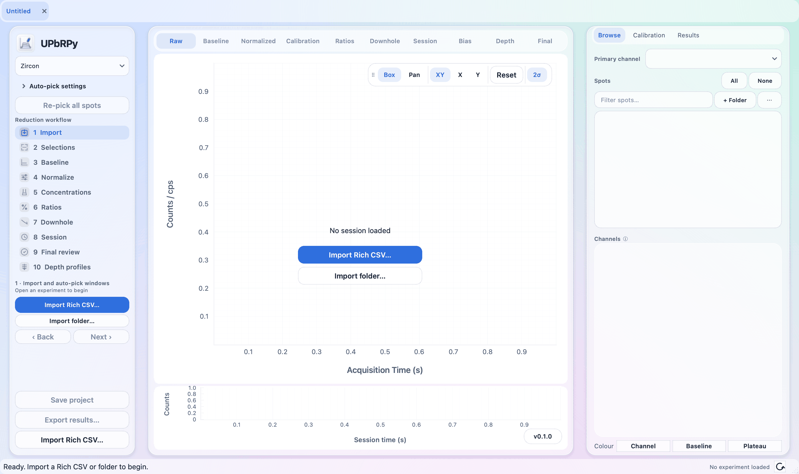
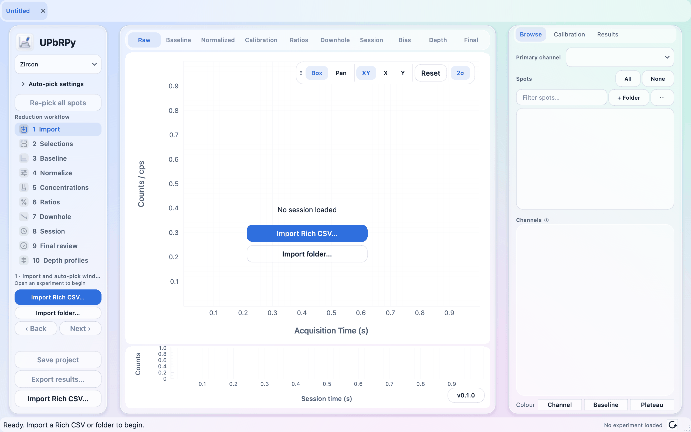

# First launch

Studio starts in the light theme. Choose the mineral workflow, then open a
Qtegra export or saved project. Each project occupies a tab with independent
settings and results. A dot before the tab title marks unsaved changes.

The left rail lists the workflow steps. **This step** contains the current
primary action, Back and Next. A later step unlocks after its prerequisite has
run; when an action completes, Next is highlighted. Background work reports
completion or failure in the status bar.

Browse on the right selects acquisitions and isotopes. Calibration contains
reference and fit choices; Results contains final decisions. Plots occupy the
centre. Use **View > Reset Layout** to fit the window to the screen, or View
to restore collapsed panels. Auto-pick settings start folded on a laptop.

Save the first project with Command/Ctrl+S, choosing a `.upbr` destination.
Keep raw exports with it: a project records paths, settings and selections,
rather than embedding all raw measurements. See [Projects and bundles](../data-model/project-and-bundle.md).
