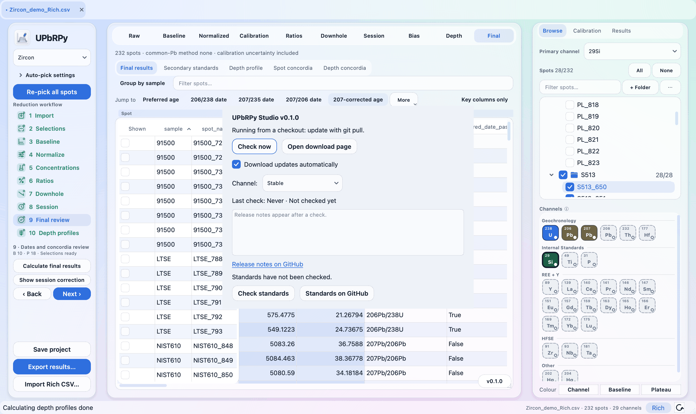

# Updates

Choose **Help > Check for updates**, or click the version chip on the plot.
The status-bar update button also checks and opens a compact result popup;
**Update settings…** opens the full dialog. Escape or an outside click closes
the popup. The dialog shows the version, channel, last check and release notes.

Choose **Stable** for published releases or **Beta (pre-releases)** to include
pre-release versions. With automatic downloads on, an available update downloads
in the background. Otherwise choose Download. Studio verifies the archive with
SHA-256 before offering **Restart to update**. A writable packaged application
checks shortly after launch and every six hours.

Source checkouts and applications that cannot replace themselves show a reason
and link to the download page. Update a source checkout using your normal source
workflow. The screenshot shows the checkout message; no update availability or
release information has been simulated.

A reference-library warning is separate from an application update. Review a
changed library before acknowledging its warning, because it can affect later
reductions. See [the release mechanism](../in-app-updates.md) for development details.
