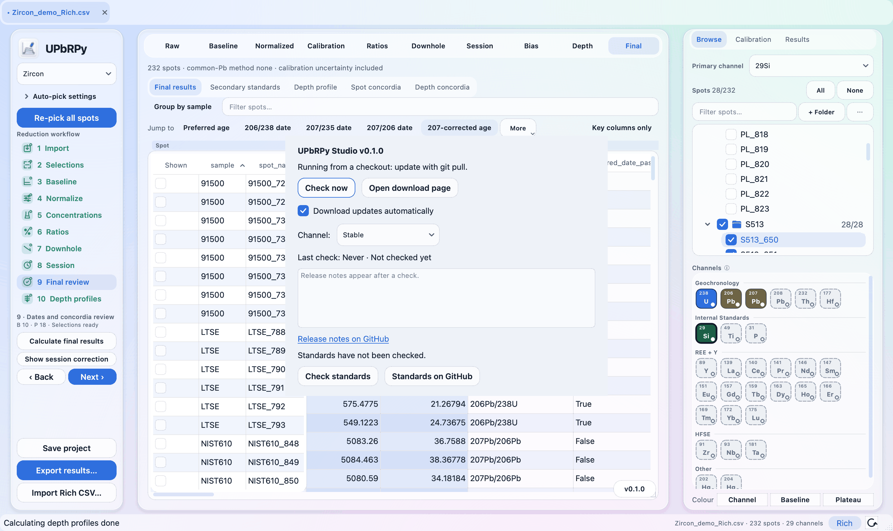

# In-app updates

Studio checks GitHub Releases for an application update, verifies the downloaded
archive with SHA-256 and offers a restart to install it. The version chip and
Help menu open the Updates dialog. See [Updates](get-started/updates.md) for
user instructions.

## Mechanism

- `GUI/updates.py` (pure Python, no Qt): version comparison (PEP 440 style
  with pre-releases: `0.2.0b1 < 0.2.0`), release selection from the GitHub
  Releases API (`https://api.github.com/repos/duserzym/UPbRPy/releases`;
  drafts are skipped; pre-releases only on the Beta channel), choosing the
  asset for this platform (`UPbRPy-Studio-<version>-macOS-arm64.zip` or
  `UPbRPy-Studio-<version>-Windows-x86_64.zip`), and reading the expected
  SHA-256 from the release's `SHA256SUMS.txt` asset.
- `GUI/updates.py` also defines the state machine (idle, checking, none,
  available, downloading, ready, installing, error, unsupported).
- `GUI/updater.py` (Qt): a worker thread that
  uses only the standard library (`urllib`) for the API call and the download
  (to a temporary folder, with progress), verifies the SHA-256 before anything
  is touched, and the relaunch.
- Relaunch: macOS unpacks `UPbRPy Studio.app` next to the running bundle,
  then starts a detached shell script that waits for Studio to quit, moves the
  old bundle aside (`UPbRPy Studio.previous.app`, deleted on the next
  successful start), moves the new one into place, clears the quarantine flag
  and opens it. Windows does the same with the `UPbRPy Studio` folder through a
  detached `cmd` script. A copy that cannot be replaced (not writable, or not
  the frozen application: running from a checkout) is "unsupported": the dialog
  says so and offers the download page instead.
- The check runs 8 seconds after launch and every 6 hours. With
  "Download updates automatically" on (the default) an available update is
  downloaded quietly and the chip turns into "Update ready, restart".
- Channels: Stable takes the newest published release that is not a
  pre-release; Beta includes pre-releases (tags like `v0.2.0b1`).
- Only GET requests to GitHub are sent: the releases list, checksums and the
  download. No
  telemetry. Tests never reach the network: `urllib.request.urlopen` is
  patched, and `UPBRPY_BLOCK_IMPORTS` stays as it is.

## What the user sees

- **Check for updates button**: a circular-arrow icon at the far right of the
  status bar in each reduction tab. Clicking checks immediately and opens a
  small popup above the button with the result, current version, and the same
  Download / Restart to update / download-page actions as the Updates dialog.
  Download appears when automatic downloads are off. A dot marks an available
  update, a ready download, or an update known to a build that cannot replace
  itself. Checking and downloading animate the arrow when the Qt style permits
  animation; the popup always reports the operation in text. Escape, an outside
  click, or another click on the button closes the popup. "Update settings…"
  opens the existing dialog. Opening during a check or download shows its
  current progress without starting another check.
- **Version chip**: a small pill in the bottom-right corner of the plot canvas
  in every reduction tab: `v0.1.0`. It becomes `Update available` or
  `Update ready, restart` with a dot when there is something to do, shows
  `Checking` or `Downloading 43%` while busy, and `Check failed` after an
  error. Clicking it opens the Updates dialog. Help > Check for updates opens
  the same dialog and checks at once.
- **Updates dialog**: current version, the last check time and result,
  **Check now**, **Download** (when automatic downloads are off), **Restart to
  update** (when the download is verified), "Download updates automatically",
  the channel (Stable / Beta), the release notes and a link to the releases
  page.

## Release flow

1. Bump `version` in `pyproject.toml`, commit and push.
2. Tag `vX.Y.Z` (or `vX.Y.ZbN` for the Beta channel) and push the tag.
3. The `Build desktop applications` workflow (`v*` tags and manual dispatch
   only) runs the tests, builds and smoke-tests the frozen app on macOS arm64
   and Windows x86-64, and on a tag attaches the two zips and `SHA256SUMS.txt`
   to a draft GitHub Release. Publish the draft and installed copies see it
   at their next check.

A manual run builds the same zips as workflow artifacts and creates no
release.

## One-time setup (the owner does this)

Nothing. The updater verifies downloads against `SHA256SUMS.txt` from the
same release over HTTPS; there is no signing key and no secret. (Apple
notarization and Windows code signing remain separate, as before.)

## Checks in the repository

- `tests/test_updates.py`: version comparison, release and asset selection,
  checksum parsing, the state machine, and the worker with `urlopen` patched
  (no network).
- `tests/test_updates_gui.py`: the chip and the dialog render offscreen at
  1440 x 900 and 1280 x 800 in light and dark; with `UPBRPY_SCREENSHOTS=1`
  the test writes `docs/assets/screenshots/studio_updates_*.png`.
- The button and popup are tested at 1512 x 982, 1280 x 800 and the shell's
  minimum 760 x 620, in light and dark. `scripts/shot_check_updates.py` writes
  `check-updates-idle.png` and `check-updates-available.png` (with popup) to
  `SHOT_DIR`, or `docs/assets/screenshots` by default. It supports
  `QT_QPA_PLATFORM=offscreen` and uses temporary preferences and no network.
- `Updater(preview=...)` (or `UPBRPY_UPDATE_PREVIEW`) accepts `idle`, `none`,
  `available`, `downloading`, `ready`, `error`, `unsupported`, and `checking`.
  A manual preview check shows checking for about 600 ms, then restores the
  scenario (`idle` resolves to `none`). `checking` stays busy indefinitely;
  opening during `downloading` preserves its progress. Preview actions never
  download or install anything.
