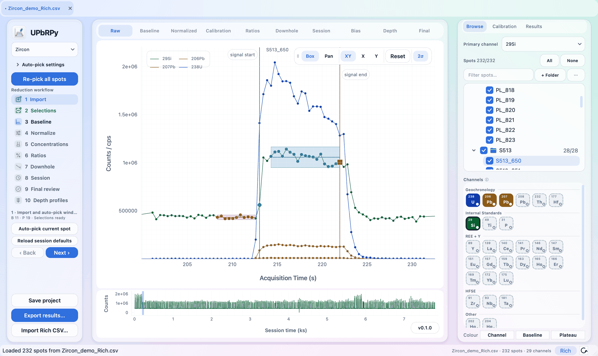

---
hide:
  - toc
---

# UPbRPy Studio

Reduce LA-ICP-MS U-Pb and trace-element measurements in a desktop application
or use the same engine from Python. Studio reads Qtegra Rich and per-spot
exports and provides zircon, apatite, rutile and titanite workflows.

[Install Studio](get-started/install.md){ .md-button .md-button--primary }
[Open a session](get-started/open-session.md){ .md-button }

{ .hero-shot }

## Follow the workflow

The cards follow the zircon preset. Run each action, review its result, then
continue with Next. Other mineral presets adapt reference choices and selection
defaults. The screenshots show real measurements with neutral labels; acquisition
metadata is not displayed. They are interface examples, not reported sample results.

- **[Import](manual/import.md)**

    Read exports and inspect auto-picks.

- **[Selections](manual/selections.md)**

    Review baseline, plateau and signal windows.

- **[Baseline](manual/baseline.md)**

    Subtract the measured gas blank.

- **[Internal normalization](manual/normalization.md)**

    Normalize intensities with the mineral matrix.

- **[Concentrations](manual/concentrations.md)**

    Calibrate with measured reference glasses.

- **[Raw isotope ratios](manual/ratios.md)**

    Build ratios from baseline-subtracted signals.

- **[Downhole correction](manual/downhole.md)**

    Review fractionation through each ablation.

- **[Session fractionation](manual/session.md)**

    Correct drift through session time.

- **[Dates and concordia review](manual/final-results.md)**

    Inspect spot results, flags and references.

- **[Depth-profile export](manual/depth-profiles.md)**

    Review corrected full-signal sweeps.

- **[Export results](manual/export.md)**

    Prepare tables and reproducibility products.

- **[Database](manual/database.md)**

    Sign in, link a session and submit a run.

## Understand the measurements

Read [Key ideas](guide/key-ideas.md), [Counting and dwell time](guide/counting-and-dwell.md)
and [Choosing an export](guide/choosing-an-export.md) for the concepts behind
the controls. The [data model](data-model/index.md) defines inputs, acquisition
objects, saved projects and exported quantities. The [Python API](reference/python-api.md)
uses the same numerical pipeline as Studio.

Use [UPbDB](https://github.com/duserzym/upbdb) to store raw sessions and reduction
runs, and [UPb Lab](https://github.com/duserzym/upblab) to open sessions in Studio
and review results after submission. Local reduction needs neither service.
