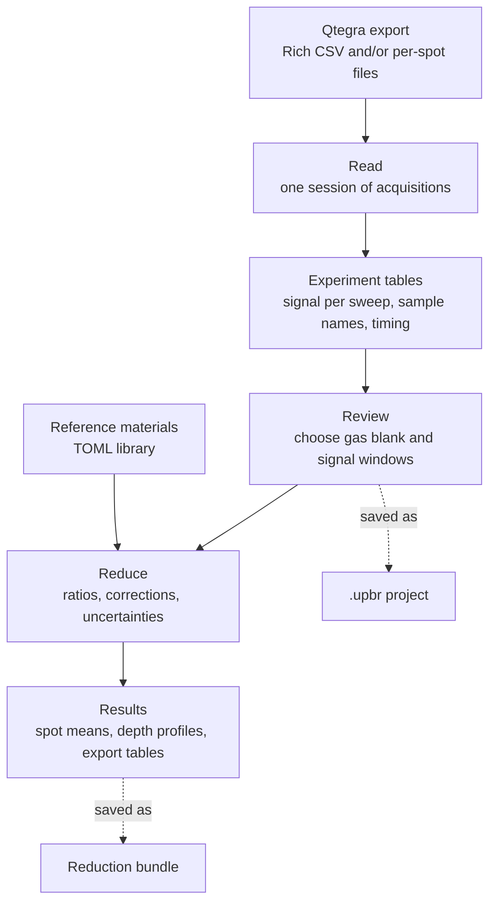

# UPbRPy documentation

UPbRPy turns laser-ablation ICP-MS measurements of U, Th and Pb isotopes into
isotope ratios, dates and trace-element concentrations, and records every step so
a reduction can be repeated. This site explains what UPbRPy reads, what it keeps
from each file, and what it writes.

-   :material-lightbulb-on-outline: **Start here: key ideas**

    ---

    What an acquisition, a sweep, a channel and a count rate are, in plain
    words, with one picture of how a measurement is laid out.

    [:octicons-arrow-right-24: Key ideas](guide/key-ideas.md)

-   :material-counter: **Counts, count rates and dwell time**

    ---

    Why the instrument's "counts per second" cannot be used directly as a
    number of ions, and what that means for uncertainties.

    [:octicons-arrow-right-24: Counting and dwell time](guide/counting-and-dwell.md)

-   :material-file-export-outline: **Which Qtegra export should I use?**

    ---

    A short decision guide: what each export contains and what you lose
    without it.

    [:octicons-arrow-right-24: Choosing an export](guide/choosing-an-export.md)

-   :material-book-open-variant: **Reference**

    ---

    The exact file layouts, data structures, reference-material files,
    project files and export tables, field by field.

    [:octicons-arrow-right-24: Data model reference](data-model/index.md)

## How data moves through UPbRPy

## What UPbRPy Studio looks like

UPbRPy Studio is the desktop program built on UPbRPy. You review each laser
spot, choose its gas blank and signal windows, and step through the reduction
from the list on the left.

=== "Reviewing a spot"

    <figure markdown="span">
      { loading=lazy }
      <figcaption>Step 1, Import: the signal of one spot against time, with the chosen signal window marked by the green and orange lines. Below it, the whole session at a glance; on the right, the spot list and isotope picker.</figcaption>
    </figure>

=== "Checking results"

    <figure markdown="span">
      { loading=lazy }
      <figcaption>Step 9, Final review: spot means on a concordia diagram, coloured by sample. Selecting spots reports their concordia age and MSWD.</figcaption>
    </figure>

!!! info "Recent change that affects uncertainties (2026-11-11)"
    Before this date, UPbRPy calculated the counting uncertainty of each sweep
    as if the instrument's count rate were the number of ions detected. That
    made sweep-level uncertainties several times too small. Spot averages were
    not affected. [Read what changed and why](guide/counting-and-dwell.md).

The source code is on [GitHub](https://github.com/duserzym/UPbRPy).
