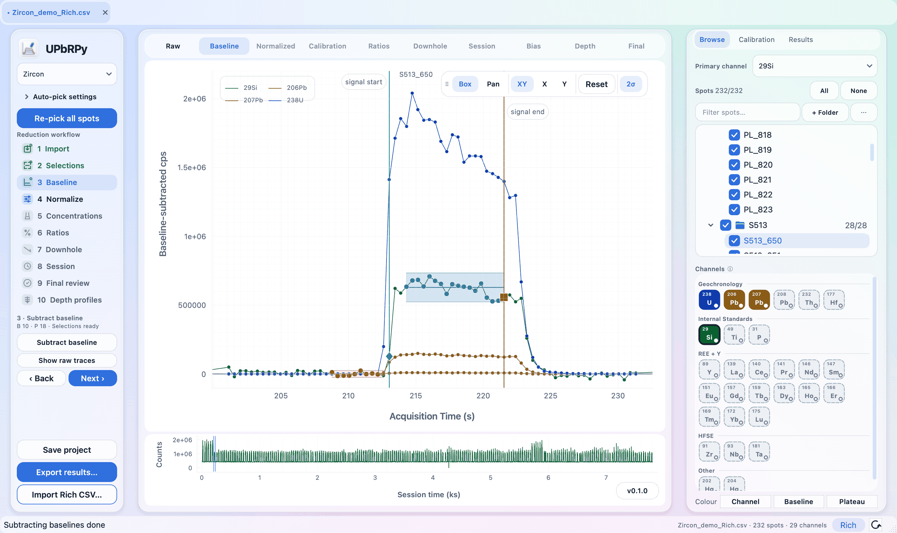

# Subtract baseline

## What this step does

Subtracts each spot's mean baseline separately for every measured channel.
The same reviewed windows feed the engine and Studio.

## Controls

Run **Subtract baseline** in **This step**, then inspect the **Baseline** trace.
Choose channels in the isotope selector and move between spots in Browse.
Use Box or Pan, the XY/X/Y zoom selector, and Reset to inspect weak signals.
Panning moves both axes; the zoom-axis setting applies to wheel and box zoom.

## What to check

Confirm that the chosen blank represents the background and that the useful
signal remains interpretable. Negative or unstable low-count channels deserve
review before ratio calculation. Return to Selections to correct windows;
completed products are invalidated and recalculated after edits.
