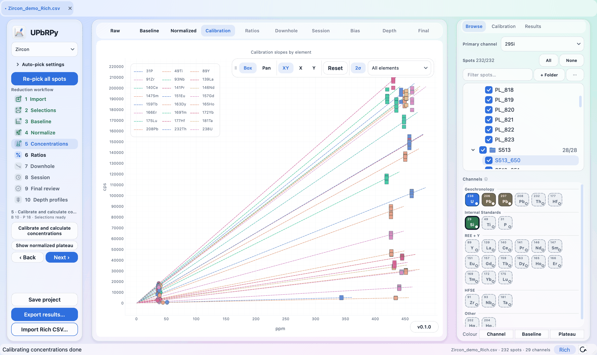

# Calibrate and calculate concentrations

## What this step does

Fits origin-anchored concentration calibration factors using the measured
reference glasses and calculates spot concentrations. Zircon defaults to
NIST610 and NIST612 when available. Concentration and isotope calculations use
the same acquisitions, with separate calibration paths.

## Controls

Check concentration standards in the Calibration inspector and run
**Calibrate and calculate concentrations**. The **Calibration** view displays
analyte calibration factors and uncertainties. Choose channels to inspect their
fits. The rutile preset additionally exposes glass-outlier filtering before
calibration; its concentration stage can include thermometry.

## What to check

Confirm that the intended glasses were measured and assigned correctly. Review
scatter and outliers before using a slope. Missing channels cannot yield measured
concentrations. Keep the reported uncertainty convention with the exported
values; the spot estimate includes the observed plateau variation.
