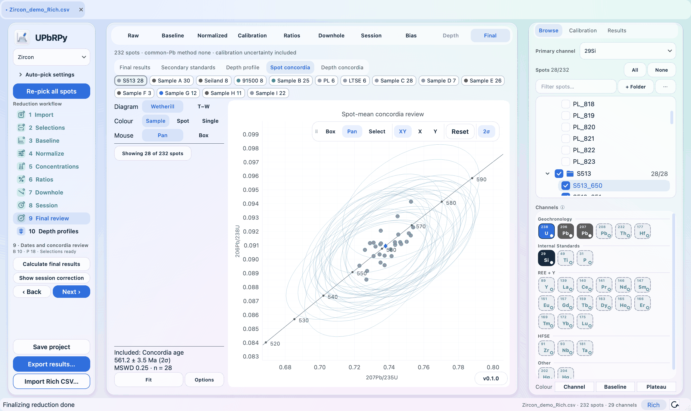

# Spot concordia

## What this view does

Displays corrected spot ratios as points and uncertainty ellipses on concordia.
The live readout reports a concordia age, 2SE, MSWD and contributing spot count
for the shown, non-excluded selection, or all shown non-excluded spots when
nothing is selected.

## Controls

Select **Spot concordia** under Final. Choose the diagram, calibration
uncertainty and colouring. **Sample** colours and a legend are the default;
**Spot** and **Single** are alternatives. Age-label spacing and precision adapt
to zoom. Hover reveals spot details, ratios and dates.

The chooser checks, sample chips, All/Clear and Glasses toggle control visibility.
Use Shift-click and Command/Ctrl-click for multiple selection; Space toggles
chooser checks. On the plot, click selects an acquisition, Shift-click extends
and Command/Ctrl-click toggles. **Select** drag mode selects a rectangle.
**H** hides the selection, **Shift+H** shows all, **Escape** clears selection,
and **E** toggles calculation exclusion. Double-click resets the plot.

**Exclude selected from calculations** is saved in the project. Excluded points
remain hollow with muted, dashed outlines and are omitted from live ages,
isochron fits and publication weighted means. Visibility choices do not change
publication exports.

Turn **Fit** on for live discordia/isochron fits. Zircon starts with Fit off;
common-Pb mineral presets start with it on. Fits use selected shown points,
or all shown points if none are selected, after calculation exclusions. **Fit
options…** offers regression models 1–3, common-Pb and age anchors, physical
constant uncertainty, a combined fit, bootstrap resamples and seed. Analytical
results appear first, followed by progressive bootstrap results. Defaults are
2000 resamples and seed 1; Studio processes 125-resample chunks with seed +
chunk index. The settings and last results are saved in the project.

**Export fits…** writes fit tables, footnotes, SVG and PNG. **Export results…**
includes the last fits from both concordia pages in its audit bundle.

## What to check

Inspect n of N, exclusions, 2s uncertainties, bootstrap intervals and fit
residuals. A large MSWD warrants checking uncertainties and geological
assumptions. See [regression methods](../isochron_regression.md) for the numerical
models and validation. A visually close fit alone does not establish a valid age.
