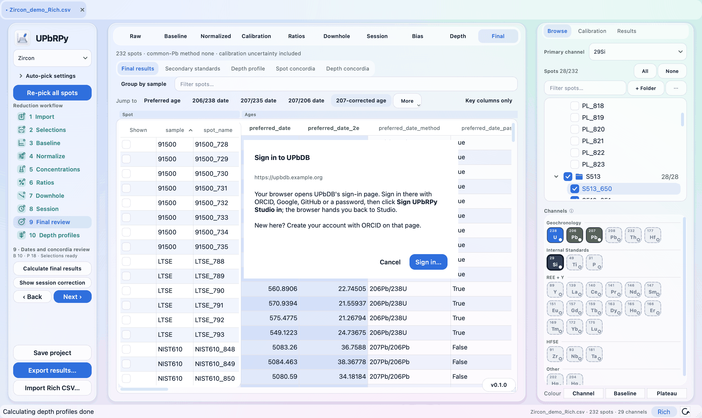

# Database: sign in, link and submit



## What this integration does

[UPbDB](https://github.com/duserzym/upbdb) stores raw sessions, acquisitions,
spot links and reduction runs. Studio downloads session bundles, performs the
reduction and submits new runs. [UPb Lab](https://github.com/duserzym/upblab)
opens a selected session in the separate Studio application and reviews the
results after submission.

## Controls

Source installations need the database extra:

```sh
python -m pip install -e ".[gui,database]"
```

Use **File > Database > Sign In…** and enter your lab's server address, for
example `https://upbdb.example.org` (a placeholder). Studio opens the server's
own sign-in page in the system browser. Choose one of the methods offered by
that server, then choose **Sign UPbRPy Studio in**. The browser returns a
one-time code to Studio. Tokens are stored per server in the OS keychain.
The screenshot shows the unsigned-in dialog; no server connection was made.

**Open from Database…** lists sessions after sign-in. A database or UPb Lab
**Reduce in UPbRPy Studio** link can also hand off a session. Studio verifies
downloaded bundle files against SHA-256 and opens the included raw exports and
project. The database origin stays with the reduction.

For a reduction opened locally, use **Link to Database Session…** before
submitting. Review the proposed match: Studio compares acquisition labels,
counts and available raw-file hashes. Link only the corresponding session.
**Submit to Database** writes and uploads a reduction bundle as a new run;
review its confirmation and any quarantined items. **Mark as Preferred** is a
separate confirmed action on the run just submitted. Final review also exposes
these actions in This step and the Results inspector. Command/Ctrl+Shift+D
submits the active reduction.

`upbrpy-gui --open` accepts a folder, `.upbr`, session-bundle ZIP or supported
`upbr://` link. macOS app bundles register the scheme. On Windows the
**Register upbr:// Links** action or `--register-url-scheme` registers the
portable executable. A second launch hands the link to the running Studio.

## What to check

Confirm the server, linked session and run before a write. Read the submission
result and quarantine details. Local reduction and file export work without a
server; missing database dependencies disable the network actions. A session
bundle ZIP can be reduced locally and its reduction bundle transferred back.
