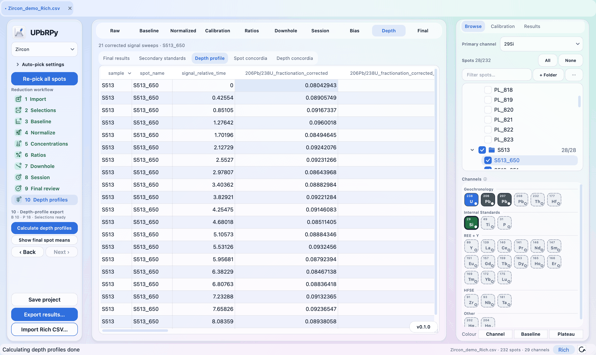
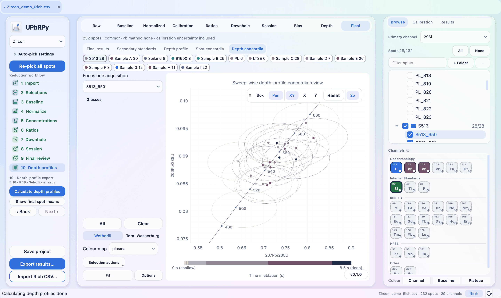

# Depth-profile export

## What this step does

Retains the corrected full-signal sweep product, so variation through an
ablation can be reviewed alongside the spot mean. Studio displays this product
as a sweep table and depth concordia. The table records time within the signal;
time is not a measured depth. A depth calibration must be supplied separately.

## Controls

Run **Depth-profile export** and use **Depth** to inspect corrected ratios,
dates and concentrations through the signal interval. Select acquisitions in
Browse. Under Final, **Depth profile** shows the
sweep table and **Depth concordia** provides the ratio-space view below.

The depth chooser groups samples and acquisitions. **Focus one acquisition**
shows a single run; chooser checks restore a multi-acquisition view. Colour
uses plasma by default, with lighter colours for shallower/earlier sweeps. The
bar identifies time in ablation or sweep position. Other colour maps are
available. Selection, visibility and calculation exclusions follow the spot
concordia controls.

Depth fits use corrected intervals, account for successive-interval
correlation, and bootstrap acquisitions, using moving blocks when fewer than
three acquisitions are available. Spot-mean fits use a parametric bootstrap.

## What to check

Look for zoning, inclusions, cracks, unstable tails and burn-through before
trusting a spot mean. Preserve corrected sweeps in the export. A depth fit
with MSWD far above one can indicate underestimated interval uncertainty;
compare the spot-mean fit and its uncertainty before reporting a result.
