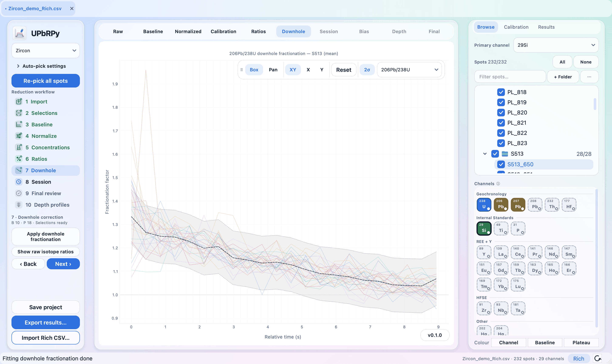

# Downhole correction

## What this step does

Stacks primary-standard ratios by position in the ablation and estimates their
within-spot fractionation trend. This correction precedes the session drift fit.

## Controls

Confirm the primary references for Pb/U, Pb/Pb and Th/Pb in **Calibration**.
Run **Downhole correction** and inspect the **Downhole** view. The fit selector
offers pointwise mean, interpolated, linear, exponential, cubic spline,
running mean and polynomial methods. Method-specific controls include window
length and polynomial degree; the outlier threshold controls fit rejection.

## What to check

Use an appropriate primary reference measured during the session. Compare the
fit with the observed sweeps, including the start and end of the selected
interval. A curve that follows isolated spikes or extrapolates poorly calls
for reviewing the windows or model. Keep secondary references independent for
later assessment.
