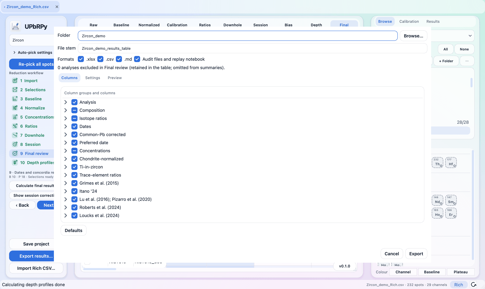

# Export results

## What this dialog does

Writes a publication table with explicit uncertainty branches and per-system
reference comparisons, with optional audit products for reproducibility.

## Controls

Choose **Export results…**, an output folder, a file stem and the formats
(the chips beside the file stem).

The left side lists the column groups as cards, in four sections: core table,
trace elements, the thermometer for the session's mineral, and literature
indices. The thermometer and the literature indices appear only for zircon
sessions, except that rutile and titanite sessions get their own thermometer.

- **Card checkbox.** Selects all or none of a card's columns.
- **Chips.** Each chip is one column. Optional columns have a dotted border.
- **Chevron.** Opens a collapsed card.
- **Citation.** Each card names its source in a short form such as
  Grimes et al. (2015).
- **i button.** Shows the full reference, a DOI link, what the index is for,
  and its main caveat. [What the trace-element groups and thermometers are
  for](../guide/trace-element-indices.md) explains each one in plain terms.
- **Filter box.** Narrows the cards by column, group, author or DOI.
- **Presets.** **Publication** is the default selection, **Everything** adds
  every optional column, and **Minimal** keeps identifiers, U, Th, Th/U,
  ratios, dates and the preferred date. Any other choice shows as
  **Custom**. **Defaults** restores Publication and keeps the laboratory
  metadata.

The thermometer card shows the calibration and the assumed values it needs:

| Mineral | Calibrations | Assumed values |
| --- | --- | --- |
| Zircon | Ferry and Watson (2007) | aSiO₂, aTiO₂ |
| Rutile | Kohn (2020) by default, or Ferry and Watson (2007) | P for Kohn (2020); aSiO₂ for Ferry and Watson (2007) |
| Titanite | Hayden et al. (2008) | aSiO₂, aTiO₂, P |

The tooltips give each formula and its constants. The footnote of the exported
file records the calibration and every assumed value.

The right side previews the export and has three tabs:

- **Columns & footnotes** updates as you choose. It lists the columns that will
  be written and the footnotes that go with them.
- **Table** shows headings, rows and sample summaries.
- **Settings** holds acquisition metadata, the table title, the discordance
  definition and threshold, and CSV precision. Enter only metadata supported
  by the acquisition record. Unavailable fields are identified as "not
  recorded" in footnotes.

Column, thermometer and setting choices persist in the project.

The default products are `<stem>.xlsx`, `.csv` and `.md`. Excel keeps full
numeric precision with publication display formats, grouped headings and a
Reference materials sheet. CSV uses displayed values unless **CSV full
precision** is selected, and has companion sample-summary and footnote files.
Markdown contains sample blocks and numbered footnotes.

**Audit files and replay notebook** also writes the legacy publication workbook,
companion tables, selection windows, spot and depth results, reduction manifest
and a replay notebook. Calculation exclusions remain in the publication table
with an excluded note and are omitted from weighted means.

## What to check

Review the preview, reference assignments, exclusions, uncertainties and missing
metadata before writing. Retain audit products with the inputs. The public
screenshot uses the Table preview tab so acquisition metadata is not displayed.
See the [table contract](../export_table_spec.md) and
[export data model](../data-model/export-table.md) for exact quantities.
