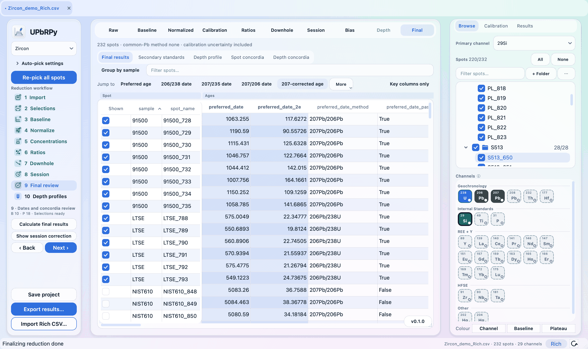

# Dates and concordia review

## What this step does

Finalizes corrected spot means, dates, common-Pb alternatives, preferred dates
and automatic flags. **Final results**, **Secondary standards**, **Spot
concordia** and **Depth concordia** are related review pages.

## Controls

Run **Dates and concordia review**, then use the Final view's tabs. **Group by
sample**, the filter and the table's navigation controls help inspect large
sessions. Right-click a spot in Browse to **Edit review flag** and record a
reason for review. Flags are saved with the project and do not alter reduction.

Check common-Pb method, uncertainty options, age transition and preferred-date
choices in the Results inspector. For common-Pb-rich minerals, inspect the
appropriate corrected branch instead of accepting a radiogenic zircon
assumption. Calibration, decay-constant, isotope-abundance and long-term
reproducibility terms have distinct meanings; see
[uncertainty and publication exports](../uncertainty_and_publication_exports.md).

## What to check

Compare primary and secondary reference results before interpreting samples.
Review flags, discordance, analytical uncertainty and calibration-inclusive
uncertainty. Check unusual acquisitions in the raw trace. Display checks and
calculation exclusions are separate: hiding a point does not remove it from
publication summaries. Continue to [Spot concordia](concordia.md) for graphical
review and live fits.
