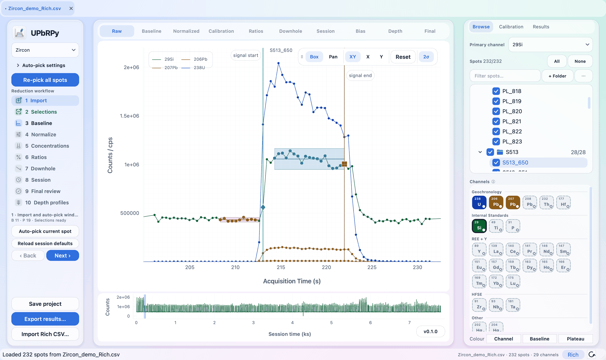

# Import and auto-pick windows

## What this step does

Reads the Qtegra exports, aligns acquisitions on the session time axis, and
picks baseline, plateau and signal intervals. Choose the mineral preset before
reviewing the picks. Zircon uses 29Si; apatite uses 44Ca, rutile 49Ti, and
titanite 29Si. Presets also select internal material and reference defaults.

## Controls

Use **File > Open Qtegra file…**, **Import Rich CSV…**, or the folder action.
The Rich CSV is the canonical export. When matching per-spot files are beside
it, Studio offers to include them. A source-format badge identifies Rich,
Per-spot folder, or their combination; its tooltip lists capabilities and warnings.
Open projects and sources in tabs; an empty tab is reused. The active tab owns
the menus, settings and reduction. A dot marks unsaved changes.

Expand **Auto-pick settings** to change the primary channel, method and window
lengths. The zircon defaults request 10 baseline sweeps and 20 plateau sweeps,
with threshold 1, filter percentile 0.3, and a 9 s nominal on-peak limit.
The threshold, running-sigma and expanding-sigma methods share the same engine
selection code. A detected shorter signal remains shorter than the limit.

The **Calibration > Detector** inspector offers **Qtegra factor** (default),
**Session constant**, and **Time drift** when Analog and Counter were exported.
Choose all acquisitions or the primary standard as the fit basis and inspect
factors by channel. Changing the detector mode re-imports the measurements and
invalidates later stages. The chosen mode and factors are recorded in reports.
See the [input contract](../data-model/acquisition-model.md) for capabilities.

## What to check

Confirm spot groups, channel names, reference identities and the primary channel.
Inspect the trace and session overview before subtracting the baseline. Check
warnings about reconstructed times or missing metadata. A Y-only UPbR export
has no timing and is rejected; obtain a Rich or per-spot export instead.

See [Open a session](../get-started/open-session.md) and
[Choosing an export](../guide/choosing-an-export.md).
