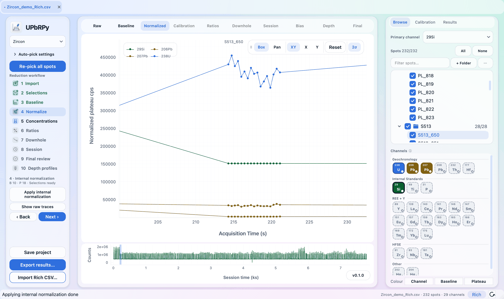

# Internal normalization

## What this step does

Normalizes baseline-subtracted plateau intensities sweep by sweep using the
preset's internal analyte and material composition. This product feeds
concentration calibration. Isotope ratios use baseline-subtracted signals.

## Controls

Run **Internal normalization**, inspect the **Normalized** traces, and confirm
the material preset and primary channel. Zircon and titanite use Si, apatite
uses Ca, and rutile uses Ti.

## What to check

Check the matrix channel for saturation, spikes and signal loss. Confirm that
the material assumption is appropriate for the selected mineral. Review a weak
analyte alongside the internal channel before continuing to concentrations.
