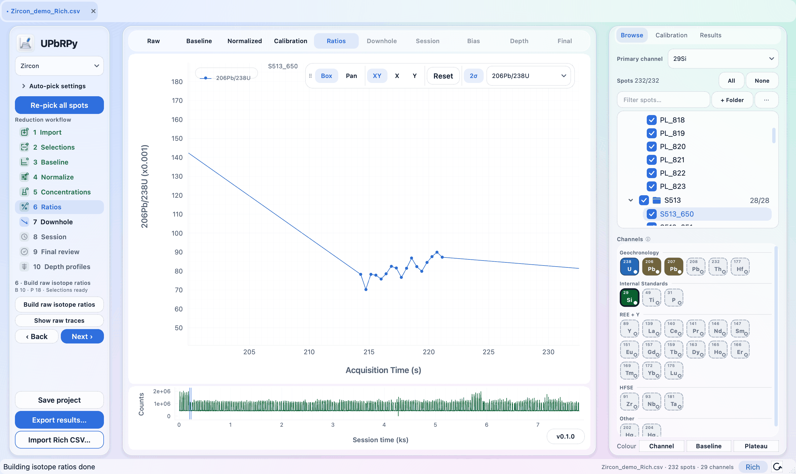

# Build raw isotope ratios

## What this step does

Builds isotope ratios from the baseline-subtracted plateau and signal sweeps.
Ratios are calculated before downhole and session fractionation corrections.
Counting terms use count rate multiplied by dwell time; cps is not a count.

## Controls

Run **Build raw isotope ratios** and choose a ratio in the **Ratios** view.
Inspect reference and sample traces. Ratio aggregation choices determine how
sweeps are combined into spot estimates; retain the choice with the reduction.

## What to check

Look for spikes, near-zero denominators and low-signal tails. Check that dwell
times were supplied or recovered by the reader. Review the
[counting and dwell explanation](../guide/counting-and-dwell.md) before
interpreting sweep-level uncertainties. Missing Hg channels limit mass-204
correction; do not interpret an unavailable correction as a zero measurement.
