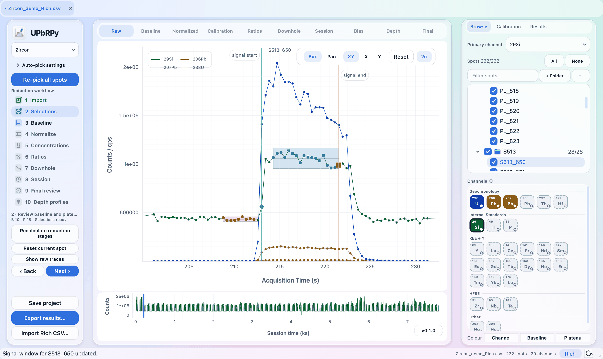

# Review baseline and plateau picks

## What this step does

Provides the manual quality check before reduction. Baseline sweeps estimate
the gas blank. Plateau sweeps determine spot means; the wider signal interval
also supplies depth profiles. The falling washout edge is detected separately.

## Controls

Select a spot in **Browse** or use the previous/next spot shortcuts. Drag the
baseline or plateau handles, or the signal-start and signal-end markers. Use
**B** or **P** to select the active window; **Alt+Left/Right** moves its start
one measured sweep, and **Alt+Shift+Left/Right** moves its end. Window changes
are applied after a short debounce and already completed stages recalculate in
the background. Moving to another spot or tab does not discard an edit.

**Reset current spot** re-picks one acquisition. **Re-pick all spots** applies
the current parameters as one undoable edit; the Selection Windows menu also
has current-sample and all-open-tab actions. Manually edited spots are kept
unless **Also overwrite manual edits** is selected. Undo and redo cover drags,
nudges and batch picks.

**Nominal on-peak** limits signal duration from the detected onset and snaps to
a measured sweep. **Auto** leaves the detected washout edge in control. The
median and 10–90% range beneath the control help compare picks across the session.
The optional iterative plateau filter marks retained points filled and rejected
points hollow; mean bars and uncertainty rectangles update with the windows.

Save a project with **Ctrl+S** (Command on macOS). Once a project has a file,
selection edits save automatically. Until the first save, Studio keeps a recovery
copy; reopening the same source offers restoration.

## What to check

Keep the baseline before the laser onset, away from spikes and washout. Keep the
plateau within useful signal, avoiding inclusions, unstable tails and transitions.
Check low-count Pb as well as the matrix channel. Do not accept a pick solely
because it was made automatically. The screenshot shows baseline, plateau and signal
edge edits on a reference acquisition.
