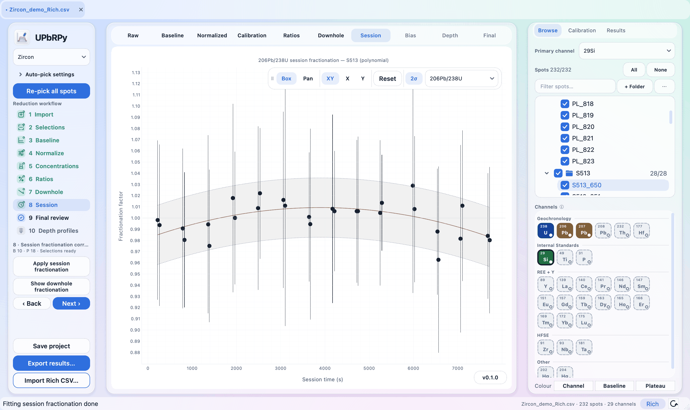

# Session fractionation correction

## What this step does

Fits the primary-standard ratios through session time after downhole correction
and applies the resulting drift model to the acquisitions.

## Controls

Run **Session fractionation correction**. Use the **Session** plot and the
Calibration inspector to choose the model and its options. The zircon preset
starts with a degree-two polynomial. Other available models include pointwise
mean, interpolation, linear, exponential, spline and running mean.

## What to check

Check how standards bracket samples and how the fit behaves at both session
ends. Review outliers and gaps in acquisition time. A flexible model is not
a substitute for appropriate standards. Compare secondary-reference results
with their accepted values after finalization and retain the calibration
uncertainty in the interpretation.
